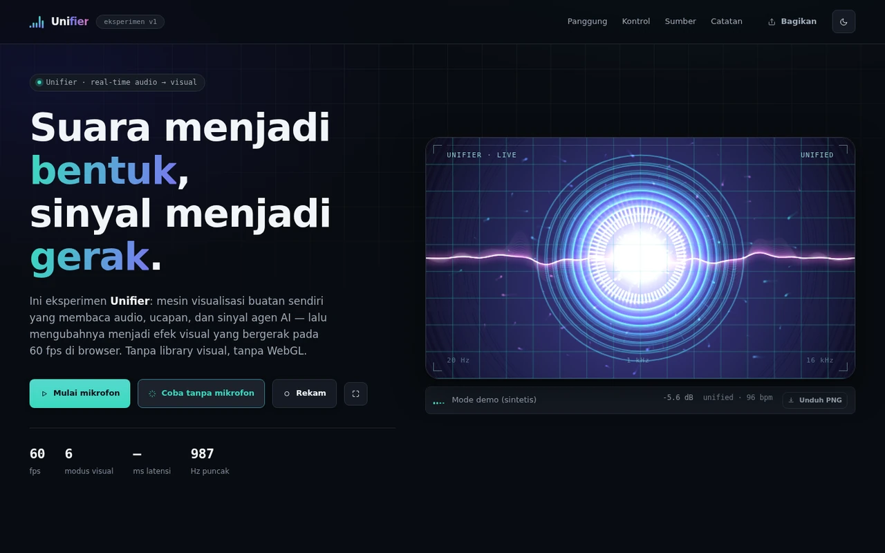
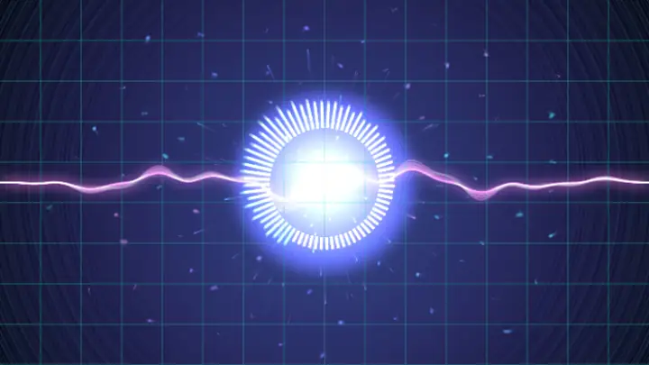
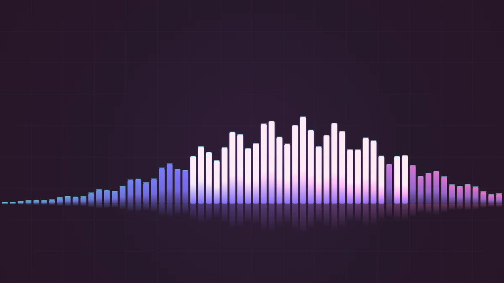
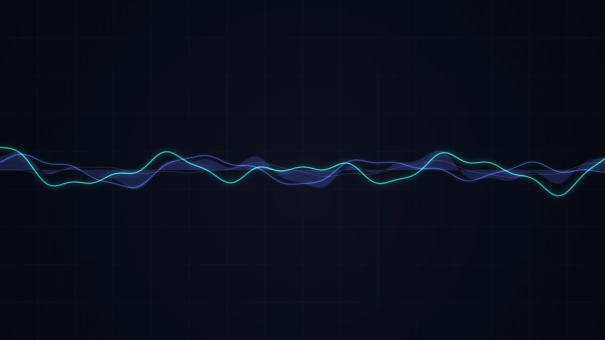
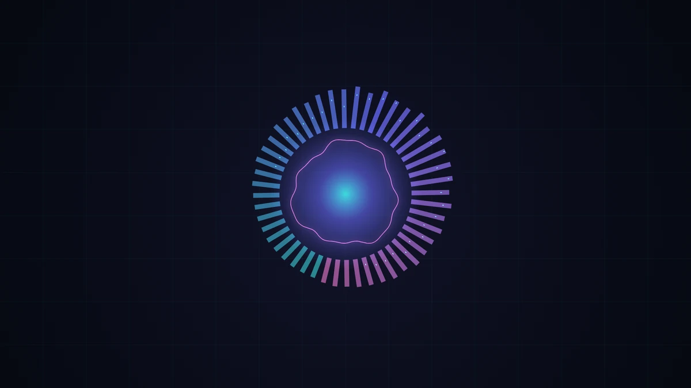
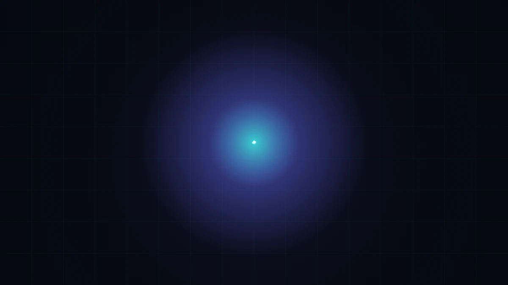
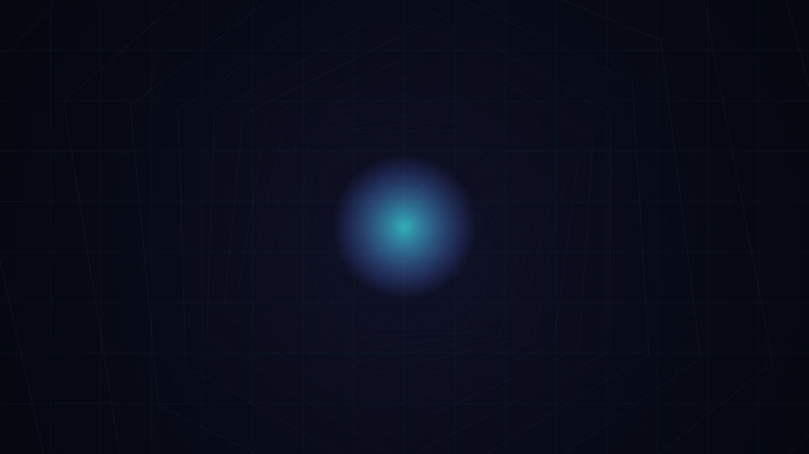
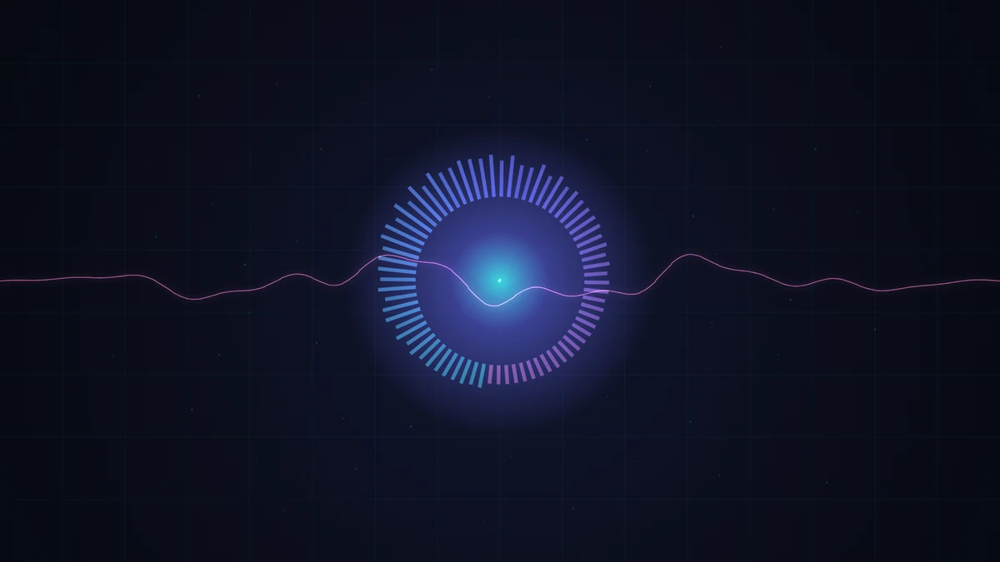
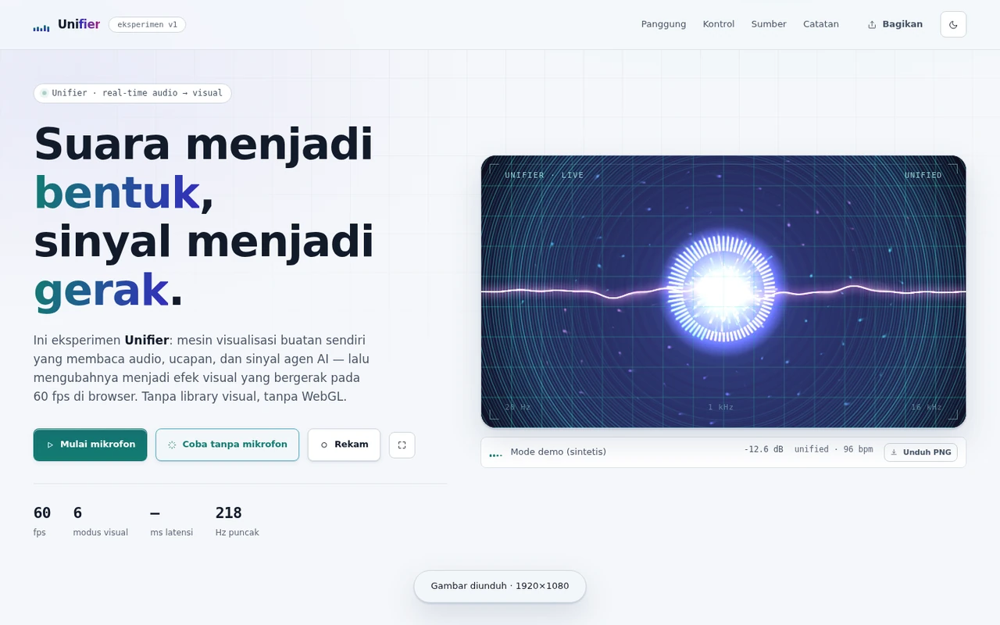

# Unifier — Visualisasi Suara Real-time

Eksperimen visualisasi suara buatan sendiri. Unifier membaca **audio**, **ucapan**,
dan **sinyal agen AI**, lalu mengubahnya menjadi efek visual yang bergerak pada 60 fps
di browser.

Tanpa library visual, tanpa WebGL, tanpa proses build yang wajib. Empat berkas
JavaScript, satu mesin analisis, enam renderer.

**Demo langsung:** https://antono4.github.io/Unifier/



<p align="center"><sub><i>Mode Unified berjalan di atas feed demo — tangkapan dari aplikasi yang sedang berjalan.</i></sub></p>



<p align="center"><sub><i>Pratinjau bergerak — diambil langsung dari kanvas, 28 bingkai. Visualisasi real-time tidak bisa ditunjukkan oleh gambar diam.</i></sub></p>

---

## Apa yang diuji

Ide intinya sederhana: tiga jenis masukan yang sangat berbeda bentuknya bisa
dilebur menjadi **satu representasi fitur** yang sama, lalu dirender oleh mesin yang
sama.

| Sumber | Masuk sebagai | Direpresentasikan sebagai |
| --- | --- | --- |
| Mikrofon / berkas / osilator | `AnalyserNode` FFT 2048 | 64 pita logaritmik + gelombang + ketukan |
| Ucapan (SpeechRecognition / TTS) | kata & fonem | denyut + pita fonem |
| Agen AI (skenario / WebSocket) | peristiwa JSON | denyut, kilatan, partikel, guncangan |

Semua jalur bermuara pada satu objek `frame`:

```js
{
  bands, peaks,        // 64 pita logaritmik + puncak dengan peluruhan sendiri
  wave,                // 1024 sampel untuk digambar
  level, db, centroid, flux,
  beat, bpm,           // deteksi ketukan dari energi pita rendah
  pulse, flashTool, flashError, flashDone, speech, tokens,
}
```

Renderer tidak pernah tahu dari mana sinyal itu datang. Itulah inti ide “Unifier”.

---

## Menjalankan

```bash
# server statis apa pun; Web Audio butuh http/https, bukan file://
python3 -m http.server 12000
# lalu buka http://localhost:12000/
```

Untuk menguji jalur WebSocket:

```bash
node tools/ws-server.mjs            # ws://localhost:8787/events
```

Lalu tempel URL itu ke kolom **Aliran langsung** di bagian *Sumber*.

### Build opsional

```bash
python3 tools/build.py        # dist/unifier.html (CSS + JS di-inline) + robots/sitemap/manifest
python3 tools/make_assets.py  # kartu sosial + ikon PNG  (butuh: pip install pillow)
```

`dist/unifier.html` adalah berkas tunggal tanpa permintaan jaringan apa pun —
berguna untuk arsip atau untuk membukanya langsung dari disk.

---

## Enam modus visual

| Modus | Cara kerjanya |
| --- | --- |
| **Spektrum** | 64 pita logaritmik, puncak VU-meter, cermin bawah, label frekuensi opsional |
| **Gelombang** | sampai 5 lapis gelombang berlapis dengan fase berlawanan + pita isian |
| **Radial** | spektrum memutar + cincin gelombang + orb inti yang bernapas |
| **Partikel** | medan pusaran dari diferensial pita; kecepatan dan warna per partikel dari pita asalnya |
| **Terowongan** | heksagon berperspektif yang menjauh; kecepatan mengikuti tingkat sinyal |
| **Unified** | semua lapisan sekaligus — motes, spektrum, gelombang, partikel, cincin, kilatan |

<table>
<tr>
<td width="33%"><br><sub><b>Spektrum</b></sub></td>
<td width="33%"><br><sub><b>Gelombang</b></sub></td>
<td width="33%"><br><sub><b>Radial</b></sub></td>
</tr>
<tr>
<td><br><sub><b>Partikel</b></sub></td>
<td><br><sub><b>Terowongan</b></sub></td>
<td><br><sub><b>Unified</b></sub></td>
</tr>
</table>

<p align="center"><sub><i>Keenam gambar di atas dihasilkan oleh tombol <b>Unduh PNG</b> itu sendiri — 1920×1080, lalu diperkecil untuk README.</i></sub></p>

## Palet

`aurora` · `ember` · `ion` · `moss` · `mono` — masing-masing tiga berhenti, diambil
dengan ramp di seluruh pita. Palet juga menulis ulang `--s1/--s2/--s3` pada
dokumen, jadi UI ikut berubah warna.

---

## Analisis sinyal

**Pita.** Batas pita dipetakan secara logaritmik dari 38 Hz ke 16 kHz ke dalam bin
FFT, lalu magnitudo dinormalkan dan dinaikkan ke pangkat 0,85 supaya pita tinggi
tidak tenggelam.

**Redaman temporal.** Serangan cepat (≈0,45) dan pelepasan lambat (≈0,87) per pita,
sehingga batang tidak berkedip pada sinyal berderau. Puncak punya peluruhan konstan
terpisah supaya terbaca seperti VU meter.

**Ketukan.** Energi empat pita terendah dibandingkan dengan rata-rata bergerak 43
bingkai; ambang 1,32× dengan jendela refraktori 190 ms. Interval antar ketukan
dirata-ratakan menjadi perkiraan BPM.

**Centroid & flux.** Centroid spektral memberi “kecerahan” (menggeser puncak
spektrum sintetis dan intensitas turbulensi partikel); flux memberi “gerakan”.

**Mesin sintetis.** Saat tidak ada masukan perangkat, `SyntheticEngine` menghasilkan
pita, gelombang, dan denyut secara deterministik dari jam, termasuk envelope mirip
ucapan (ledakan suku kata di dalam jeda frasa). Karena itu halaman tidak pernah
mati — dan seluruh visualisasi bisa diuji tanpa perangkat audio.

---

## Peristiwa agen → efek visual

| Peristiwa | Efek |
| --- | --- |
| `start` | denyut pembuka |
| `thinking` | denyut rendah berulang |
| `tool` | kilatan sapuan sian + denyut kuat |
| `token` | denyut kecil + satu partikel |
| `speech` | denyut ucapan |
| `error` | guncangan merah radial |
| `done` | halo yang mengembang |

Skema WebSocket-nya minimal:

```json
{ "type": "thinking", "intensity": 0.7 }
{ "type": "tool", "name": "browser.search" }
{ "type": "token", "text": "hasil" }
{ "type": "error", "message": "timeout" }
{ "type": "done" }
```

---

## Kontrol

- **Modus** — 6 pilihan, atau tombol <kbd>1</kbd>–<kbd>6</kbd>, <kbd>Space</kbd> untuk berikutnya
- **Sensitivitas · Kehalusan · Kompleksitas · Kecepatan · Jejak** — semua langsung berlaku
- **Sakelar** — kisi latar, glow, cermin bawah, label frekuensi
- <kbd>M</kbd> mikrofon · <kbd>D</kbd> demo · <kbd>R</kbd> rekam · <kbd>S</kbd> unduh PNG · <kbd>F</kbd> layar penuh · <kbd>T</kbd> tema

**Setiap kontrol ditulis ke URL.** Tombol *Bagikan* menyalin tautan yang membuka
ulang panggung persis seperti yang Anda lihat — misalnya:

```
?mode=unified&palette=ember&complexity=1.6&trails=0.93
```

**Aksesibilitas.** `prefers-reduced-motion` dipatuhi: kecepatan diturunkan ke 0,35×
dan ditampilkan di HUD. Tema terang/gelap, navigasi tab yang bisa dioperasikan
dengan tombol panah, `scroll-margin-top` untuk header lengket, dan tidak ada
kegagalan kontras WCAG AA di kedua tema.



<p align="center"><sub><i>Tema terang. Kontras diaudit dengan mengukur warna yang benar-benar tergambar, bukan dengan membaca CSS.</i></sub></p>

## Mengunduh hasil

Ada dua cara menyimpan hasilnya, dan keduanya menyimpan berkas yang nyata —
bukan tangkapan layar jendela.

**Gambar (PNG).** Tombol *Unduh PNG* di bawah panggung menggambar ulang bingkai
saat itu ke kanvas di luar layar berukuran tetap **1920×1080**, lalu mengunduh
PNG. Ukurannya sengaja tidak mengikuti ukuran jendela: kalau mengekspor kanvas
apa adanya, hasilnya akan berbeda-beda di tiap layar. Karena renderer-nya sama,
gambar yang keluar identik dengan yang Anda lihat, hanya dengan resolusi lebih
tinggi daripada tampilan. Renderer dibangun ulang untuk ekspor ini, sehingga
gambar tidak bergantung pada sudah berapa lama halaman dibuka.

Nama berkasnya menyimpan pengaturannya:

```
unifier-unified-aurora-1920x1080.png
         └ modus  └ palet  └ ukuran
```

**Video (MP4).** Tombol *Rekam* memakai `canvas.captureStream(60)` +
`MediaRecorder` dan mengunduh **MP4 (H.264)** langsung dari kanvas, 8 Mbps.
Pilihannya mencoba H.264 High → Main → Baseline → `video/mp4` polos, lalu jatuh ke
VP9/VP8/WebM bila browser tidak bisa membungkus MP4 — Firefox dan Safari belum
semuanya bisa, dan lebih baik mereka dapat WebM daripada tidak bisa merekam sama
sekali. Ekstensi berkas mengikuti kontainer yang benar-benar dipakai perekam, bukan
yang diminta, karena `MediaRecorder` kadang memilih sendiri.

---

## Struktur

```
index.html               satu halaman, semua bagian
css/tokens.css           warna, skala tipe (9 langkah), spasi, kedalaman, gerak
css/style.css            tata letak + komponen
js/audio-engine.js       analisis Web Audio, osilator, mesin sintetis, Unifier
js/sources.js            ucapan, TTS, skenario agen, WebSocket langsung
js/visualizers.js        6 renderer Canvas 2D + overlay bersama
js/app.js                UI, loop RAF, HUD, perekam + ekspor PNG, status URL
tools/build.py           build satu berkas + robots/sitemap/manifest
tools/make_assets.py     kartu sosial + ikon (Pillow)
tools/ws-server.mjs      feed peristiwa demo (WebSocket, tanpa dependensi)
tools/make-shots.mjs     tangkapan layar + bingkai animasi untuk README
docs/                    gambar README (WebP statis + pratinjau bergerak)
tools/test/smoke.mjs     108 pemeriksaan di Chromium sungguhan
```

## Pengujian

```bash
npm i puppeteer-core
node tools/test/smoke.mjs            # 108 pemeriksaan
node tools/test/smoke.mjs --shots    # + tangkapan layar ke .agent_tmp/
```

Uji ini menjalankan halaman sungguhan di Chromium tanpa kepala dan **mengukur apa
yang benar-benar tergambar**, bukan hanya membaca DOM:

- jumlah frame per detik dan level sinyal yang bukan nol
- statistik piksel kanvas per modus (jumlah warna, luminans maksimum) untuk
  memastikan tiap modus benar-benar melukis sesuatu dan berbeda satu sama lain
- jalur mikrofon nyata dengan perangkat palsu Chrome
- peristiwa agen dan feed WebSocket sungguhan (server demo dijalankan lalu dihubungi)
- bolak-balik status URL, tema, dan pintasan papan ketik
- audit kontras WCAG AA di kedua tema, dengan komposit lapisan tembus pandang
- build satu berkas: tanpa permintaan jaringan dan tanpa galat konsol

---

## Catatan

Dibuat sebagai eksperimen untuk proyek **Unifier**. Canvas 2D dipilih daripada WebGL
supaya seluruh mesin bisa dibaca dan dimodifikasi di satu tempat, dan tetap berjalan
di perangkat tanpa GPU.

Lisensi: MIT
